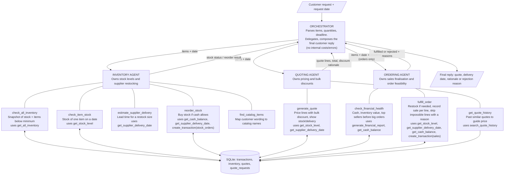

# Munder Difflin Agent Workflow (4 agents, smolagents)

Responsibility boundaries: the inventory agent is the only one that answers stock questions and reorders proactively;
the quoting agent never writes to the database; the ordering agent is the only one that records sales
(it restocks only as a side effect of a confirmed order). `find_catalog_items` is a read-only lookup shared by the workers.

`init_database` and `generate_sample_inventory` are used by the test harness to build the database and starting stock.
